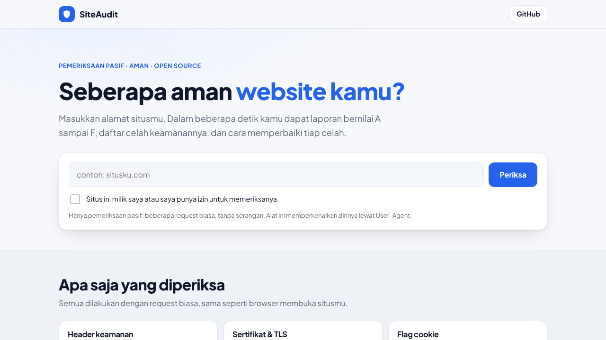
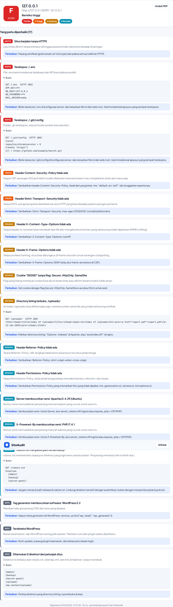

<div align="center">

# 🔍 SiteAudit

**Masukkan alamat situsmu, dapatkan laporan nilai A-F berisi celah keamanannya dan cara memperbaiki tiap celah.**


[English](#english) &middot; [Cara pakai](#cara-pakai) &middot; [Yang diperiksa](#yang-diperiksa) &middot; [Keamanan & etika](#keamanan--etika)



</div>

## Kenapa dibuat

Kebanyakan orang nggak tahu situsnya bocor sampai ada yang masuk. Padahal banyak celah umum bisa ketahuan cuma dari membaca respons situs, tanpa menyerang apa pun: header keamanan yang hilang, file `.env` yang kebuka, sertifikat kedaluwarsa, cookie tanpa proteksi.

SiteAudit mengirim beberapa request biasa ke situsmu, membaca responsnya, lalu menyusun laporan: nilai **A sampai F**, daftar masalah menurut tingkat bahaya, dan **cara memperbaiki tiap masalah** yang tinggal kamu terapkan.



## Yang diperiksa

Semua pasif. SiteAudit nggak pernah mencoba login, menebak password, atau mengirim payload serangan.

| Area | Isi |
|---|---|
| Header keamanan | CSP, HSTS, X-Content-Type-Options, X-Frame-Options, Referrer-Policy, Permissions-Policy |
| Sertifikat & TLS | Versi TLS lama, masa berlaku sertifikat, sertifikat self-signed |
| Cookie | Flag Secure, HttpOnly, SameSite |
| File sensitif | `.env`, `.git/config`, `phpinfo.php`, backup, `.htaccess`, `server-status`, dan lainnya |
| Kebocoran versi | Header `Server` / `X-Powered-By`, tag generator, deteksi WordPress |
| CORS | Origin yang dipantulkan sembarangan, wildcard dengan kredensial |
| Penemuan direktori | Direktori situs ditemukan dari robots.txt, sitemap.xml, dan link di halaman (tanpa wordlist), lalu dicek apakah directory listing-nya terbuka |

Deteksi file sensitif memakai baseline anti soft-404, lalu mencocokkan isi file, jadi tidak asal menandai halaman 200.

**Setiap temuan disertai bukti.** Bukan sekadar "ada masalah", tapi apa persisnya: potongan isi file yang terekspos (dengan password otomatis disensor), judul halaman directory listing, atau path yang bocor dari robots.txt. Jadi kamu tahu celahnya di mana dan bisa langsung memperbaikinya.

Penemuan direktori sengaja **tidak memakai wordlist**: tool hanya memeriksa path yang situsmu sendiri sebutkan (di robots.txt, sitemap.xml, dan link halaman), jadi tetap pasif dan sopan ke server.

## Cara pakai

Butuh PHP 8.1+ dengan ekstensi **openssl** (wajib, untuk situs https) dan sebaiknya **curl**.

Di Windows, buka `php.ini`, lalu hapus tanda `;` di depan baris berikut, dan pastikan `extension_dir = "ext"` aktif:

```ini
extension=openssl
extension=curl
```

Cek sudah aktif: `php -m` harus menampilkan `openssl`.

```bash
git clone https://github.com/bramcps/web-security-auditor.git
cd web-security-auditor
php -S localhost:8000 router.php
# buka http://localhost:8000
```

Lewat terminal, tanpa tampilan web:

```bash
php bin/scan.php situsku.com
```

Menjalankan tes:

```bash
php tests/run.php
```

## Keamanan & etika

Memindai situs orang lain tanpa izin bisa melanggar hukum. SiteAudit dibuat untuk situs milikmu sendiri atau yang kamu diberi izin memeriksanya, dan beberapa hal dibangun untuk menjaga itu:

- **Butuh pernyataan izin** sebelum memindai.
- **Hanya pasif**: tidak ada brute force, tidak ada percobaan eksploitasi.
- **Memperkenalkan diri** lewat User-Agent, tidak menyamar.
- **Proteksi SSRF**: target yang menunjuk ke `localhost`, IP privat, atau alamat metadata cloud (`169.254.169.254`) ditolak, dengan resolusi IP yang dipin agar tidak bisa di-rebind.
- **Rate limit** per IP di endpoint web.

> `AUDITOR_ALLOW_PRIVATE=1` hanya untuk menguji target lokal saat pengembangan. **Jangan pernah** menyalakannya di server publik: itu membuka celah SSRF ke jaringan internalmu.

## Struktur

```
public/           tampilan web (HTML, CSS, JS)
api/scan.php      endpoint JSON
src/              Http (klien aman), Tls, Checks, Grade, Scanner
bin/scan.php      penjalan via terminal
tests/run.php     tes tanpa dependency
router.php        router untuk `php -S`
```

## Kontribusi

Tambahan pemeriksaan pasif baru sangat diterima: path sensitif lain, header baru, atau deteksi versi rentan. Tambahkan di `src/Checks.php`, tambahkan tesnya di `tests/run.php`, pastikan `php tests/run.php` lolos, lalu kirim pull request. Lihat [CONTRIBUTING.md](CONTRIBUTING.md).

## English

**SiteAudit** is a passive web security auditor with a PHP backend. Enter your site's URL and get an A-F report of its security issues with a concrete fix for each one: missing security headers, exposed `.env` / `.git`, weak TLS, insecure cookies, version disclosure, and risky CORS. Every check is passive (plain requests, no attacks), the scanner identifies itself, and it refuses private/loopback/metadata targets to avoid SSRF. It also discovers your site's directories from its own robots.txt, sitemap, and page links (no wordlist, no brute force), flags open directory listing, and backs every finding with evidence (redacted file snippets, listing titles, leaked paths). Built for sites you own or are authorized to test. Dependency-free; run with `php -S localhost:8000 router.php`.

## Lisensi

[MIT](LICENSE) © 2025 Mas Bram

Berguna? Kasih ⭐ di GitHub.
